<!-- MASTER-HEADER-START -->
<div align="center">

<a href="https://0xcyberlitech.com/">
  
</a>

<p align="center">
  <a href="https://0xcyberlitech.com/"></a>
  <a href="https://0xcyberlitech.com/soc-rd.html"></a>
  <a href="https://0xcyberlitech.com/jarvis-rd.html"></a>
  <a href="https://github.com/0xCyberLiTech?tab=repositories"></a>
</p>
<p align="center">
  <a href="README.md"></a>
</p>


</div>
<!-- MASTER-HEADER-END -->

<!-- DEBIAN-TRUTH-START -->
> [!IMPORTANT]
>  ** Matrice Officielle Debian — `Debian 12 (Bookworm)` · `Debian 13 (Trixie)` · `Debian 14 (Forky)`**
> - **Sources Officielles Debian.org (`zabbix`) :** `Bookworm (12)` : **`1:6.0.14+dfsg-1`** &nbsp;·&nbsp; `Trixie (13 — Stable)` : **`1:7.0.22+dfsg-1~deb13u1`** &nbsp;·&nbsp; `Forky (14 — Next-Gen)` : **`1:7.0.29+dfsg-2`**
> - **Références Officielles :** [Paquet Debian Trixie (`zabbix-server-mysql`)](https://packages.debian.org/trixie/zabbix-server-mysql) &nbsp;·&nbsp; [Paquet Debian Forky (`zabbix-server-mysql`)](https://packages.debian.org/forky/zabbix-server-mysql) &nbsp;·&nbsp; [Documentation Officielle Debian](https://packages.debian.org/trixie/zabbix-server-mysql)
> - **Note d'Ingénierie (Divergence 13 vs 14) :** Sous Debian 13 (Trixie) et Debian 14 (Forky), privilégiez **`zabbix-agent2`** (écrit en Go, support natif Docker/Smartctl/Systemd) et les commandes `mariadb` / `php8.4-fpm`.

<details>
<summary> <b>Afficher les Encarts Ligne de Commande : Debian 13 (Trixie — Stable) vs Debian 14 (Forky — Next-Gen)</b></summary>

####  Profil Production Stable — Commandes pour `Debian 13 (Trixie)`
```bash
# Debian 13 (Trixie — Zabbix 7.0 LTS / 7.4 & MariaDB 11.4 / PHP 8.4) :
sudo systemctl status zabbix-server zabbix-agent2 apache2 mariadb
sudo journalctl -u zabbix-server -n 50 --no-hostname
```

####  Profil Anticipation Next-Gen — Commandes pour `Debian 14 (Forky)`
```bash
# Debian 14 (Forky) — Depot Zabbix au format DEB822 (/etc/apt/sources.list.d/zabbix.sources) :
sudo zabbix_server -R config_cache_reload
sudo zabbix_agent2 -t agent.ping
```

</details>
<!-- DEBIAN-TRUTH-END -->

<!-- CIEL-PEDAGOGY-START -->
<details>
<summary> <b>Synthèse d'Architecture, Standards Officiels &amp; Diagnostic (Niveau 1 : Fondamentaux · Niveau 2 : Repères · Niveau 3 : Diagnostic)</b></summary>

- **Niveau 1 — Fondamentaux &amp; Principe d'Architecture :** **Zabbix 7.4** est une plateforme industrielle de télémétrie et de supervision qui collecte en temps réel les métriques systèmes (via `zabbix-agent2` en Go), réseau (`SNMPv3`) et hyperviseurs (API REST), évalue des déclencheurs (**Triggers**) et orchestre les notifications d'incidents.
- **Niveau 2 — Repères Officiels (Ports IANA, Fichiers Debian &amp; Commandes de Validation) :** **Ports IANA :** `TCP 10050` (Agent passif) · `TCP 10051` (Serveur / Agent actif) · `UDP 161` (SNMP) · `TCP 443` (Web UI) &nbsp;|&nbsp; **Fichiers Debian :** `/etc/zabbix/zabbix_server.conf` et `/etc/zabbix/zabbix_agent2.conf` &nbsp;|&nbsp; **Validation officielle :** `sudo zabbix_agent2 -t agent.ping`.
- **Niveau 3 — Diagnostic d'Incidents &amp; Ingénierie Avancée :** **Diagnostic & Architecture :** Si un hôte demeure injoignable, vérifiez la concordance stricte du paramètre `Hostname=` et de l'IP autorisée dans `Server=` / `ServerActive=`. En mode **Passif**, le serveur interroge l'agent (`10050/tcp`) ; en mode **Actif**, l'agent initie le flux sortant vers le serveur (`10051/tcp`), traversant nativement les pare-feu.
- **Sources de Vérité Officielles Éditeurs &amp; Standards :** [Documentation Officielle Zabbix 7.4](https://www.zabbix.com/documentation/current/fr/manual) &nbsp;·&nbsp; [Dépôt Officiel Paquets Zabbix Debian](https://repo.zabbix.com/zabbix/)
- **Livres Blancs &amp; 67 Podcasts Audio R&amp;D :** [Portail 0xCyberLiTech](https://0xcyberlitech.com/) &nbsp;·&nbsp; [Livre Blanc SOC Cockpit v5.5](https://0xcyberlitech.com/soc-rd.html) &nbsp;·&nbsp; [Livre Blanc JARVIS Mark-VII](https://0xcyberlitech.com/jarvis-rd.html) &nbsp;·&nbsp; [Blueprint Logiciel &amp; Matériel RTX 5080](https://0xcyberlitech.com/blueprint-jarvis.html)

</details>
<!-- CIEL-PEDAGOGY-END -->


##  01 // ZABBIX - Création de base d'un tableau de bord sur Grafana :


Dans cette section, je vais vous montrer comment créer un tableau de bord Grafana de base en utilisant Zabbix comme source de données pour surveiller la vitesse de téléchargement et de téléchargement réseau du serveur Zabbix.

Pour créer un nouveau tableau de bord Grafana, cliquez sur Tableaux de bord > Gérer à partir de l’interface Web de Grafana.

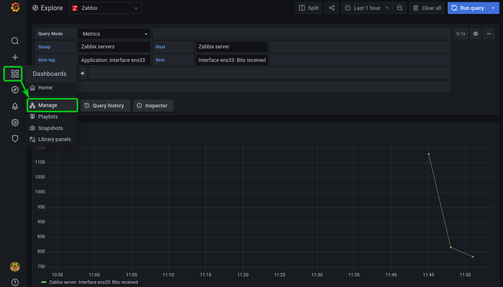

Cliquez sur Nouveau tableau de bord.

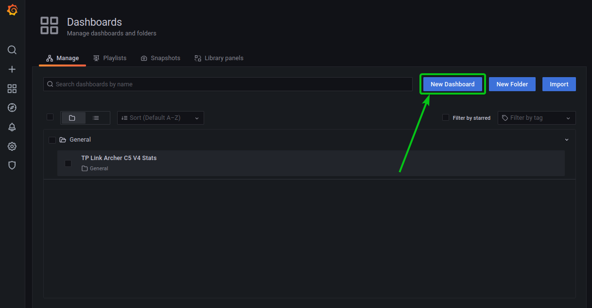

Un nouveau tableau de bord doit être créé.

Cliquez sur Ajouter un panneau vide pour ajouter un nouveau panneau au tableau de bord.

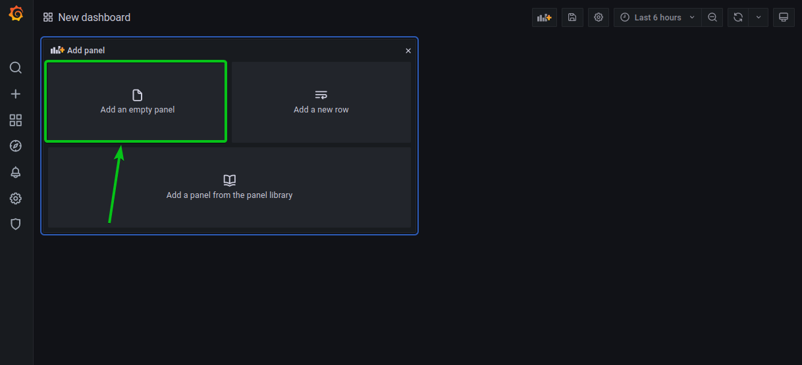

L’éditeur de panneau Grafana doit s’afficher. Vous pouvez configurer votre panneau Grafana à partir d’ici.

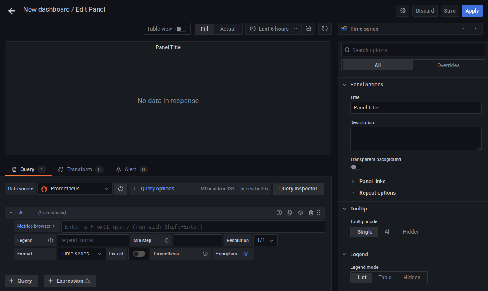

Tout d’abord, changez la source de données en Zabbix à partir du menu déroulant Source de données comme indiqué dans la capture d’écran ci-dessous.

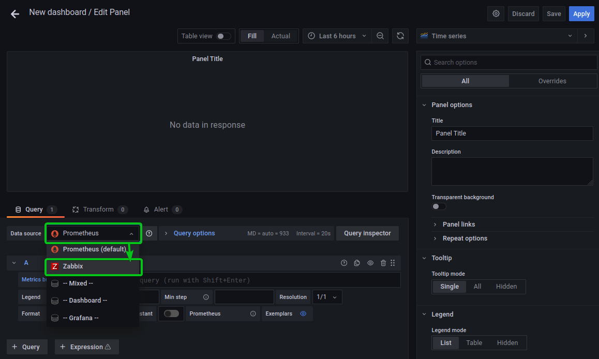

Pour surveiller la vitesse de téléchargement de votre serveur Zabbix, sélectionnez les paramètres de requête indiqués dans la capture d’écran ci-dessous.

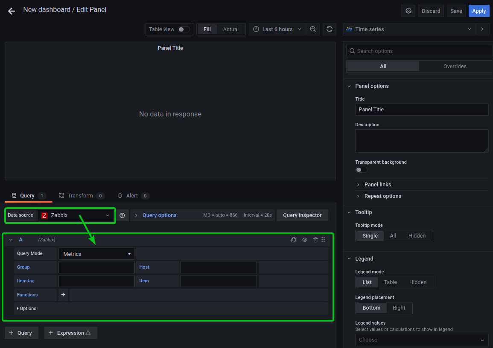

Tapez le titre Vitesse de téléchargement dans la section Titre comme indiqué dans la capture d’écran ci-dessous.

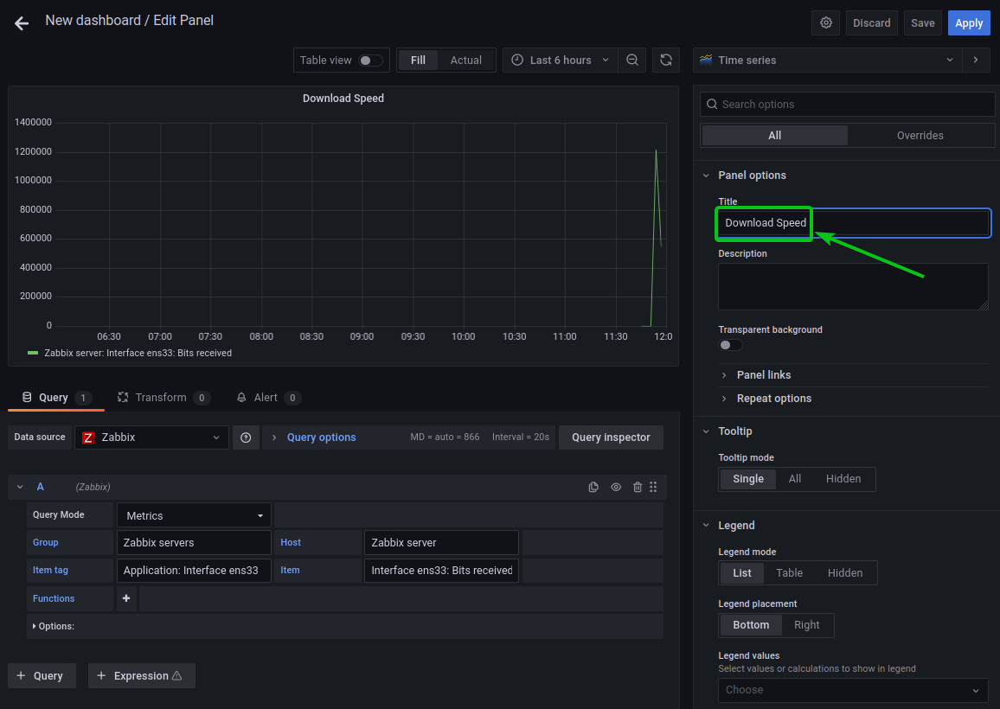

Sélectionnez l’unité Données / bits (IEC) dans la section Unité comme indiqué dans la capture d’écran ci-dessous.

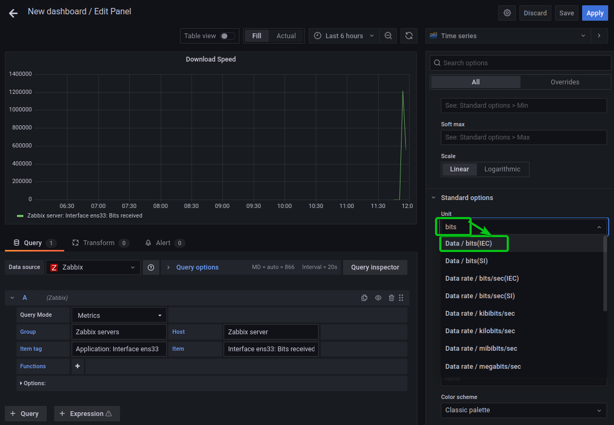

Le graphique de vitesse de téléchargement devrait afficher l’unité de données correcte comme vous pouvez le voir dans la capture d’écran ci-dessous.

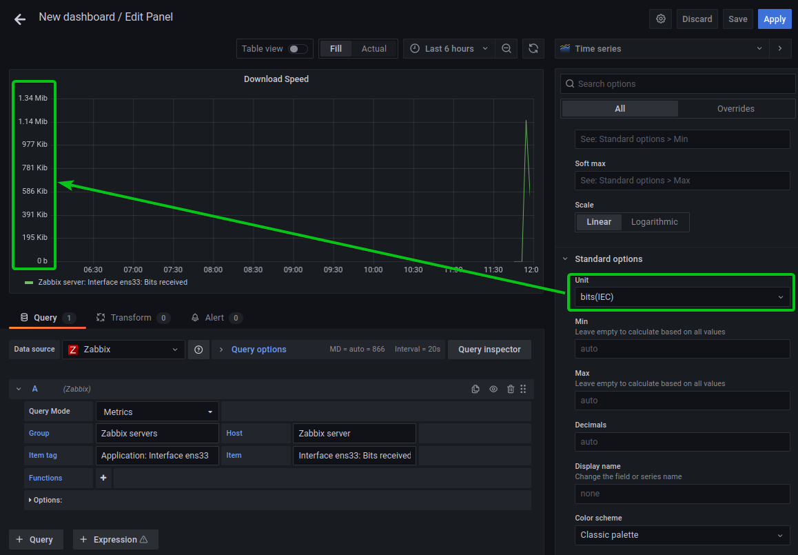

Vous pouvez effectuer de nombreuses personnalisations sur votre panneau Grafana. Vous pouvez lire l’article Comment connecter Grafana avec Prometheus? pour en savoir plus.

Une fois que vous êtes satisfait du résultat, cliquez sur Appliquer pour ajouter le panneau au tableau de bord.

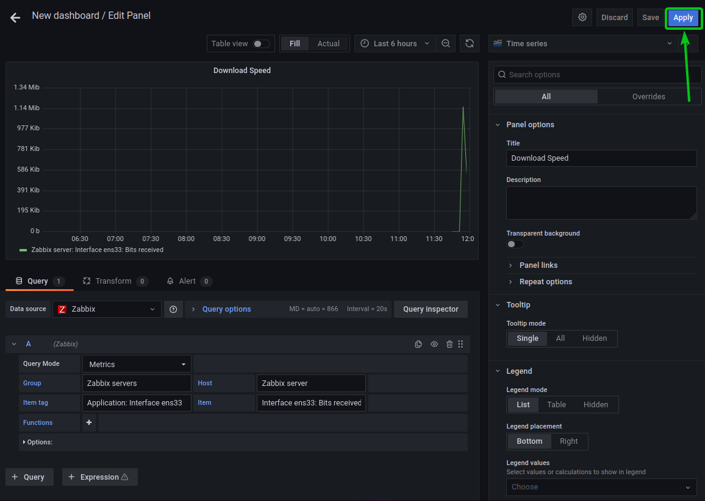

Le panneau Vitesse de téléchargement doit être ajouté au tableau de bord.

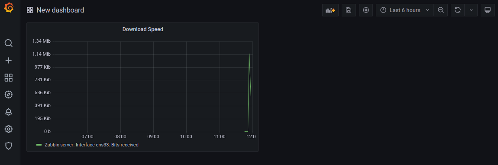

Maintenant, créons un autre panneau pour surveiller la vitesse de téléchargement du serveur Zabbix.

Comme le panneau de surveillance de la vitesse de téléchargement sera le même que le panneau Vitesse de téléchargement, vous pouvez le cloner et modifier quelques paramètres pour surveiller facilement la vitesse de téléchargement de votre serveur Zabbix.

Pour cloner le panneau Vitesse de téléchargement, cliquez sur la flèche vers le bas du panneau et cliquez sur Plus... > Dupliquer comme indiqué dans la capture d’écran ci-dessous.

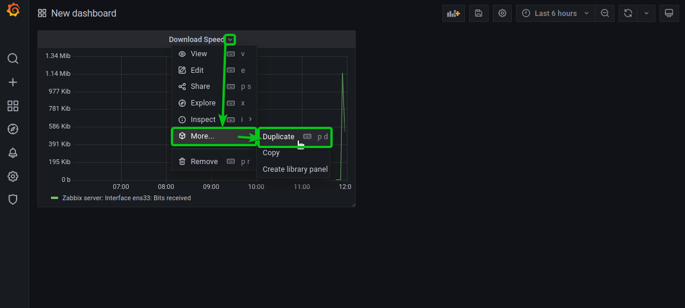

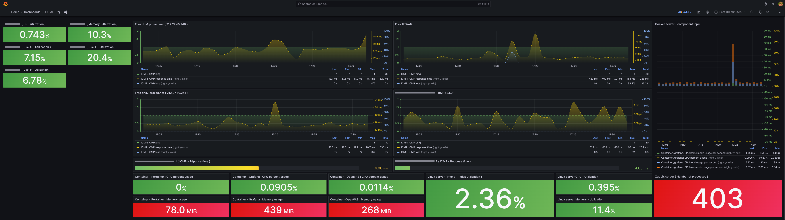

<!-- MASTER-FOOTER-START -->
<div align="center">


<a href="https://0xcyberlitech.com/">
  
</a>

<p align="center"><a href="https://0xcyberlitech.com/"></a></p>

<sub><b>Architecturé &amp; Forgé par Marc &amp; Antigravity (Google DeepMind)</b> &nbsp;·&nbsp; <a href="https://0xcyberlitech.com/"><b>0xcyberlitech.com</b></a> &nbsp;·&nbsp; <a href="https://0xcyberlitech.com/soc-rd.html">Architecture SOC Cockpit v5.5</a> &nbsp;·&nbsp; <a href="https://0xcyberlitech.com/jarvis-rd.html">Architecture JARVIS Mark-VII</a> &nbsp;·&nbsp; <a href="https://0xcyberlitech.com/blueprint-jarvis.html">Blueprint Matériel RTX 5080</a></sub>

</div>
<!-- MASTER-FOOTER-END -->
