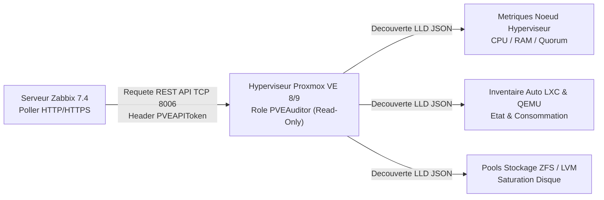

<!-- MASTER-HEADER-START -->
<div align="center">

<a href="https://0xcyberlitech.com/">
  
</a>

<p align="center">
  <a href="https://0xcyberlitech.com/"></a>
  <a href="https://0xcyberlitech.com/soc-rd.html"></a>
  <a href="https://0xcyberlitech.com/jarvis-rd.html"></a>
  <a href="https://github.com/0xCyberLiTech?tab=repositories"></a>
</p>
<p align="center">
  <a href="README.md"></a>
</p>


</div>
<!-- MASTER-HEADER-END -->

<!-- DEBIAN-TRUTH-START -->
> [!IMPORTANT]
>  ** Matrice Officielle Debian — `Debian 12 (Bookworm)` · `Debian 13 (Trixie)` · `Debian 14 (Forky)`**
> - **Sources Officielles Debian.org (`zabbix`) :** `Bookworm (12)` : **`1:6.0.14+dfsg-1`** &nbsp;·&nbsp; `Trixie (13 — Stable)` : **`1:7.0.22+dfsg-1~deb13u1`** &nbsp;·&nbsp; `Forky (14 — Next-Gen)` : **`1:7.0.29+dfsg-2`**
> - **Références Officielles :** [Paquet Debian Trixie (`zabbix-server-mysql`)](https://packages.debian.org/trixie/zabbix-server-mysql) &nbsp;·&nbsp; [Paquet Debian Forky (`zabbix-server-mysql`)](https://packages.debian.org/forky/zabbix-server-mysql) &nbsp;·&nbsp; [Documentation Officielle Debian](https://packages.debian.org/trixie/zabbix-server-mysql)
> - **Note d'Ingénierie (Divergence 13 vs 14) :** Sous Debian 13 (Trixie) et Debian 14 (Forky), privilégiez **`zabbix-agent2`** (écrit en Go, support natif Docker/Smartctl/Systemd) et les commandes `mariadb` / `php8.4-fpm`.

<details>
<summary> <b>Afficher les Encarts Ligne de Commande : Debian 13 (Trixie — Stable) vs Debian 14 (Forky — Next-Gen)</b></summary>

####  Profil Production Stable — Commandes pour `Debian 13 (Trixie)`
```bash
# Debian 13 (Trixie — Zabbix 7.0 LTS / 7.4 & MariaDB 11.4 / PHP 8.4) :
sudo systemctl status zabbix-server zabbix-agent2 apache2 mariadb
sudo journalctl -u zabbix-server -n 50 --no-hostname
```

####  Profil Anticipation Next-Gen — Commandes pour `Debian 14 (Forky)`
```bash
# Debian 14 (Forky) — Depot Zabbix au format DEB822 (/etc/apt/sources.list.d/zabbix.sources) :
sudo zabbix_server -R config_cache_reload
sudo zabbix_agent2 -t agent.ping
```

</details>
<!-- DEBIAN-TRUTH-END -->

<!-- CIEL-PEDAGOGY-START -->
<details>
<summary> <b>Synthèse d'Architecture, Standards Officiels &amp; Diagnostic (Niveau 1 : Fondamentaux · Niveau 2 : Repères · Niveau 3 : Diagnostic)</b></summary>

- **Niveau 1 — Fondamentaux &amp; Principe d'Architecture :** **Zabbix 7.4** est une plateforme industrielle de télémétrie et de supervision qui collecte en temps réel les métriques systèmes (via `zabbix-agent2` en Go), réseau (`SNMPv3`) et hyperviseurs (API REST), évalue des déclencheurs (**Triggers**) et orchestre les notifications d'incidents.
- **Niveau 2 — Repères Officiels (Ports IANA, Fichiers Debian &amp; Commandes de Validation) :** **Ports IANA :** `TCP 10050` (Agent passif) · `TCP 10051` (Serveur / Agent actif) · `UDP 161` (SNMP) · `TCP 443` (Web UI) &nbsp;|&nbsp; **Fichiers Debian :** `/etc/zabbix/zabbix_server.conf` et `/etc/zabbix/zabbix_agent2.conf` &nbsp;|&nbsp; **Validation officielle :** `sudo zabbix_agent2 -t agent.ping`.
- **Niveau 3 — Diagnostic d'Incidents &amp; Ingénierie Avancée :** **Diagnostic & Architecture :** Si un hôte demeure injoignable, vérifiez la concordance stricte du paramètre `Hostname=` et de l'IP autorisée dans `Server=` / `ServerActive=`. En mode **Passif**, le serveur interroge l'agent (`10050/tcp`) ; en mode **Actif**, l'agent initie le flux sortant vers le serveur (`10051/tcp`), traversant nativement les pare-feu.
- **Sources de Vérité Officielles Éditeurs &amp; Standards :** [Documentation Officielle Zabbix 7.4](https://www.zabbix.com/documentation/current/fr/manual) &nbsp;·&nbsp; [Dépôt Officiel Paquets Zabbix Debian](https://repo.zabbix.com/zabbix/)

</details>
<!-- CIEL-PEDAGOGY-END -->


#  Supervision d'un Cluster Proxmox VE 8/9 (Nœuds, Conteneurs LXC & VMs QEMU) par API REST dans Zabbix 7.4

> **Objectif Opérationnel :** Compléter le parcours de supervision **Zabbix 7.4** sous **Debian 12 (Bookworm)**, **Debian 13 (Trixie — Stable)** et **Debian 14 (Forky — Next-Gen)** en connectant sans agent additionnel un hyperviseur ou cluster **Proxmox VE 8 / 9** via le template officiel **`Proxmox VE by HTTP`** et un **Jeton d'API (`API Token`)** à privilèges minimaux (`PVEAuditor`).

<div align="center">

| Niveau | Étape Technique | Accès Direct |
|:---:|:---|:---:|
| **Niveau 1** | Architecture de collecte sans agent (`Proxmox VE by HTTP` & Découverte LLD) | [](#architecture-zabbix-proxmox-api) |
| **Niveau 2** | Création du compte de service `zabbix-monitor@pve` et du Jeton d'API (`PVEAuditor`) | [](#creation-api-token-proxmox) |
| **Niveau 2** | Configuration des Macros d'Hôte dans Zabbix 7.4 & Validation TLS | [](#configuration-macros-zabbix) |
| **Niveau 3** | Seuils d'alerte critiques (Stockage ZFS/LVM, Quorum Cluster, RAM LXC/QEMU) | [](#seuils-alerte-proxmox-production) |

</div>

---

<a id="architecture-zabbix-proxmox-api"></a>
##  01 // Architecture de collecte sans agent (Proxmox VE by HTTP & Découverte LLD)


Plutôt que d'installer manuellement un agent dans chaque machine virtuelle, le serveur **Zabbix 7.4** interroge directement l'**API REST native de Proxmox VE (`TCP 8006`)** à l'aide d'un jeton d'authentification en lecture seule. Le moteur **LLD (*Low-Level Discovery*)** de Zabbix découvre et crée automatiquement les indicateurs pour :

- Les **nœuds physiques** du cluster (CPU, température, charge d'E/S, état du Quorum Corosync).
- L'ensemble des **conteneurs LXC** et **machines virtuelles QEMU** (état `running`/`stopped`, consommation CPU/RAM/Disque).
- Les **volumes de stockage** (`local`, `local-lvm`, `ZFS`, `PBS`).



---

<a id="creation-api-token-proxmox"></a>
##  02 // Création du compte de service zabbix-monitor@pve et du Jeton d'API (PVEAuditor)


Sur le nœud **Proxmox VE**, appliquez le principe du moindre privilège en créant un utilisateur dédié `zabbix-monitor@pve`, attribuez-lui le rôle en lecture seule **`PVEAuditor`** sur la racine `/` et générez un jeton d'API avec séparation des privilèges désactivée (`--privsep 0`) :

<!-- CODE-WINDOW-START -->
> [!CAUTION]
> 
>
> ```ini
> pveum user add zabbix-monitor@pve --comment "Supervision Zabbix 7.4 Read-Only"
> pveum acl modify / -user zabbix-monitor@pve -role PVEAuditor
> pveum user token add zabbix-monitor@pve zbx-token --privsep 0
> ```
<!-- CODE-WINDOW-END -->

Conservez précieusement le **Token ID** (`zabbix-monitor@pve!zbx-token`) et la **valeur secrète UUID** affichée une seule fois dans le terminal.

Testez immédiatement l'accès à l'API Proxmox depuis votre serveur Debian hébergeant Zabbix :

<!-- CODE-WINDOW-START -->
> [!CAUTION]
> 
>
> ```bash
> curl -k -s -H "Authorization: PVEAPIToken=zabbix-monitor@pve!zbx-token=VOTRE_SECRET_UUID" \
>   https://192.168.1.245:8006/api2/json/cluster/resources | jq '.data | length'
> ```
<!-- CODE-WINDOW-END -->

---

<a id="configuration-macros-zabbix"></a>
##  03 // Configuration des Macros d'Hôte dans Zabbix 7.4 & Validation TLS


Dans l'interface Web de **Zabbix 7.4** (`Data collection` → `Hosts` → `Create host`), associez le template officiel **`Proxmox VE by HTTP`** et renseignez les macros suivantes dans l'onglet **Macros** :

<!-- CODE-WINDOW-START -->
> [!CAUTION]
> 
>
> ```ini
> {$PVE.URL.HOST} = 192.168.1.245
> {$PVE.URL.PORT} = 8006
> {$PVE.TOKEN.ID} = zabbix-monitor@pve!zbx-token
> {$PVE.TOKEN.SECRET} = VOTRE_SECRET_UUID
> ```
<!-- CODE-WINDOW-END -->

Pour déclencher immédiatement la découverte des conteneurs LXC et des machines virtuelles sans attendre l'intervalle par défaut d'une heure, rechargez le cache de configuration Zabbix :

<!-- CODE-WINDOW-START -->
> [!CAUTION]
> 
>
> ```bash
> sudo zabbix_server -R config_cache_reload
> sudo tail -n 30 /var/log/zabbix/zabbix_server.log
> ```
<!-- CODE-WINDOW-END -->

---

<a id="seuils-alerte-proxmox-production"></a>
##  04 // Seuils d'alerte critiques (Stockage ZFS/LVM, Quorum Cluster, RAM LXC/QEMU)


Personnalisez les macros de seuils sur l'hôte afin d'être alerté avant toute saturation de stockage ou de mémoire vive sur l'hyperviseur :

<!-- CODE-WINDOW-START -->
> [!CAUTION]
> 
>
> ```ini
> {$PVE.STORAGE.PUSED.MAX.WARN} = 75
> {$PVE.STORAGE.PUSED.MAX.CRIT} = 85
> {$PVE.CPU.PUSED.MAX.WARN} = 80
> {$PVE.MEMORY.PUSED.MAX.WARN} = 85
> ```
<!-- CODE-WINDOW-END -->

<!-- MASTER-FOOTER-START -->
<div align="center">


<a href="https://0xcyberlitech.com/">
  
</a>

<p align="center"><a href="https://0xcyberlitech.com/"></a></p>

<sub><b>Architecturé &amp; Forgé par Marc &amp; Antigravity (Google DeepMind)</b> &nbsp;·&nbsp; <a href="https://0xcyberlitech.com/"><b>0xcyberlitech.com</b></a> &nbsp;·&nbsp; <a href="https://0xcyberlitech.com/soc-rd.html">Architecture SOC Cockpit v5.5</a> &nbsp;·&nbsp; <a href="https://0xcyberlitech.com/jarvis-rd.html">Architecture JARVIS Mark-VII</a> &nbsp;·&nbsp; <a href="https://0xcyberlitech.com/blueprint-jarvis.html">Blueprint Matériel RTX 5080</a></sub>

</div>
<!-- MASTER-FOOTER-END -->
