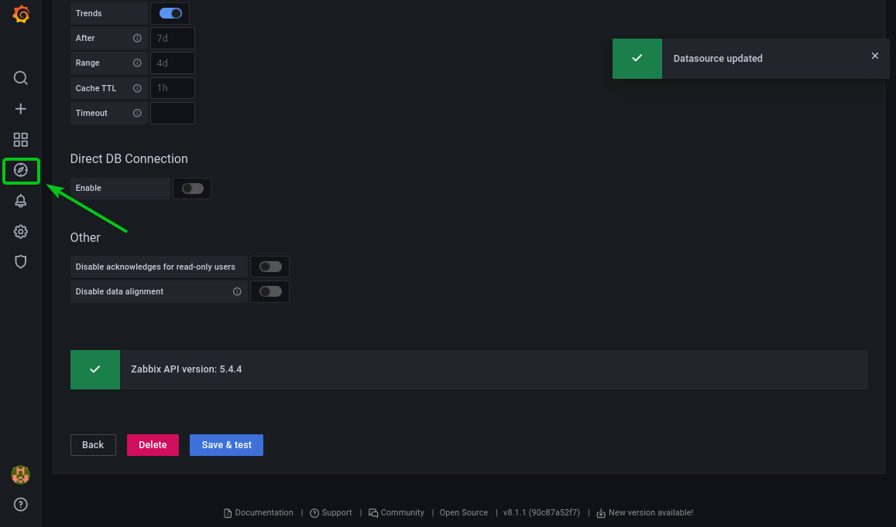
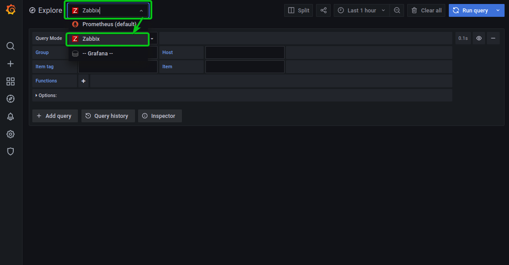
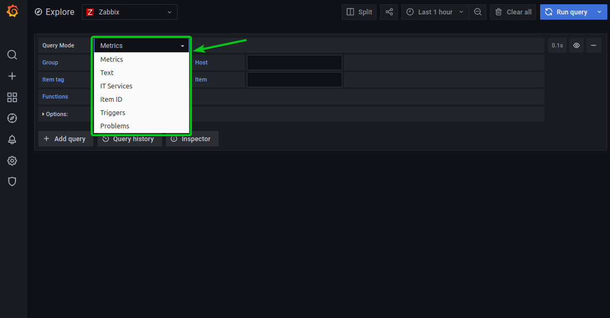
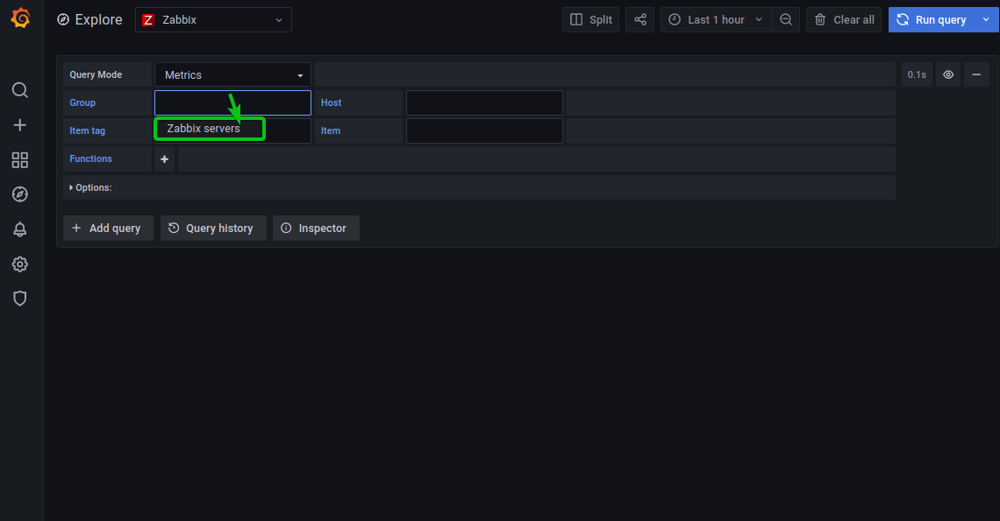
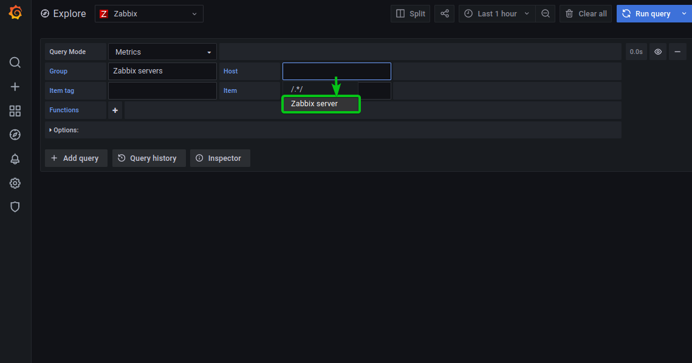
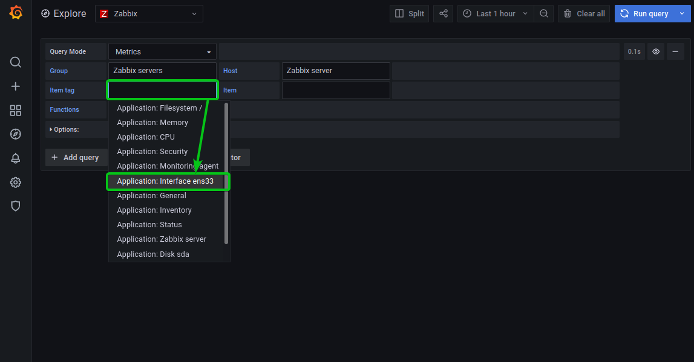
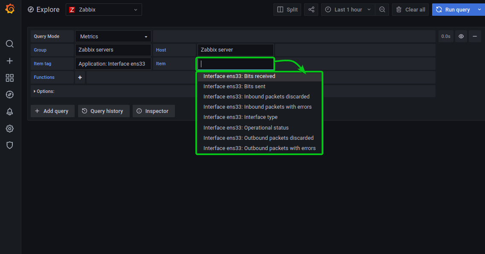
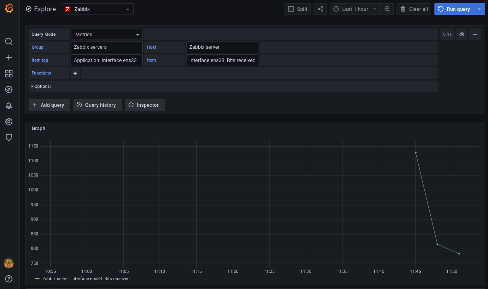

<!-- MASTER-HEADER-START -->
<div align="center">

<a href="https://0xcyberlitech.com/">
  
</a>

<p align="center">
  <a href="https://0xcyberlitech.com/"></a>
  <a href="https://0xcyberlitech.com/soc-rd.html"></a>
  <a href="https://0xcyberlitech.com/jarvis-rd.html"></a>
  <a href="https://github.com/0xCyberLiTech?tab=repositories"></a>
</p>
<p align="center">
  <a href="README.md"></a>
</p>


</div>
<!-- MASTER-HEADER-END -->

<!-- DEBIAN-TRUTH-START -->
> [!IMPORTANT]
>  ** Matrice Officielle Debian — `Debian 12 (Bookworm)` · `Debian 13 (Trixie)` · `Debian 14 (Forky)`**
> - **Sources Officielles Debian.org (`zabbix`) :** `Bookworm (12)` : **`1:6.0.14+dfsg-1`** &nbsp;·&nbsp; `Trixie (13 — Stable)` : **`1:7.0.22+dfsg-1~deb13u1`** &nbsp;·&nbsp; `Forky (14 — Next-Gen)` : **`1:7.0.29+dfsg-2`**
> - **Références Officielles :** [Paquet Debian Trixie (`zabbix-server-mysql`)](https://packages.debian.org/trixie/zabbix-server-mysql) &nbsp;·&nbsp; [Paquet Debian Forky (`zabbix-server-mysql`)](https://packages.debian.org/forky/zabbix-server-mysql) &nbsp;·&nbsp; [Documentation Officielle Debian](https://packages.debian.org/trixie/zabbix-server-mysql)
> - **Note d'Ingénierie (Divergence 13 vs 14) :** Sous Debian 13 (Trixie) et Debian 14 (Forky), privilégiez **`zabbix-agent2`** (écrit en Go, support natif Docker/Smartctl/Systemd) et les commandes `mariadb` / `php8.4-fpm`.

<details>
<summary> <b>Afficher les Encarts Ligne de Commande : Debian 13 (Trixie — Stable) vs Debian 14 (Forky — Next-Gen)</b></summary>

####  Profil Production Stable — Commandes pour `Debian 13 (Trixie)`
```bash
# Debian 13 (Trixie — Zabbix 7.0 LTS / 7.4 & MariaDB 11.4 / PHP 8.4) :
sudo systemctl status zabbix-server zabbix-agent2 apache2 mariadb
sudo journalctl -u zabbix-server -n 50 --no-hostname
```

####  Profil Anticipation Next-Gen — Commandes pour `Debian 14 (Forky)`
```bash
# Debian 14 (Forky) — Depot Zabbix au format DEB822 (/etc/apt/sources.list.d/zabbix.sources) :
sudo zabbix_server -R config_cache_reload
sudo zabbix_agent2 -t agent.ping
```

</details>
<!-- DEBIAN-TRUTH-END -->

<!-- CIEL-PEDAGOGY-START -->
<details>
<summary> <b>Synthèse d'Architecture, Standards Officiels &amp; Diagnostic (Niveau 1 : Fondamentaux · Niveau 2 : Repères · Niveau 3 : Diagnostic)</b></summary>

- **Niveau 1 — Fondamentaux &amp; Principe d'Architecture :** **Zabbix 7.4** est une plateforme industrielle de télémétrie et de supervision qui collecte en temps réel les métriques systèmes (via `zabbix-agent2` en Go), réseau (`SNMPv3`) et hyperviseurs (API REST), évalue des déclencheurs (**Triggers**) et orchestre les notifications d'incidents.
- **Niveau 2 — Repères Officiels (Ports IANA, Fichiers Debian &amp; Commandes de Validation) :** **Ports IANA :** `TCP 10050` (Agent passif) · `TCP 10051` (Serveur / Agent actif) · `UDP 161` (SNMP) · `TCP 443` (Web UI) &nbsp;|&nbsp; **Fichiers Debian :** `/etc/zabbix/zabbix_server.conf` et `/etc/zabbix/zabbix_agent2.conf` &nbsp;|&nbsp; **Validation officielle :** `sudo zabbix_agent2 -t agent.ping`.
- **Niveau 3 — Diagnostic d'Incidents &amp; Ingénierie Avancée :** **Diagnostic & Architecture :** Si un hôte demeure injoignable, vérifiez la concordance stricte du paramètre `Hostname=` et de l'IP autorisée dans `Server=` / `ServerActive=`. En mode **Passif**, le serveur interroge l'agent (`10050/tcp`) ; en mode **Actif**, l'agent initie le flux sortant vers le serveur (`10051/tcp`), traversant nativement les pare-feu.
- **Sources de Vérité Officielles Éditeurs &amp; Standards :** [Documentation Officielle Zabbix 7.4](https://www.zabbix.com/documentation/current/fr/manual) &nbsp;·&nbsp; [Dépôt Officiel Paquets Zabbix Debian](https://repo.zabbix.com/zabbix/)

</details>
<!-- CIEL-PEDAGOGY-END -->


##  01 // ZABBIX - Surveillance avec Grafana :


Pour tester si vous pouvez surveiller Zabbix avec Grafana, cliquez sur l’icône Explorer de Grafana comme indiqué dans la capture d’écran ci-dessous.



Sélectionnez Zabbix dans le menu déroulant Explorer comme indiqué dans la capture d’écran ci-dessous.



Maintenant, sélectionnez le type de données que vous souhaitez interroger à partir de Zabbix dans le menu déroulant Mode de requête, comme indiqué dans la capture d’écran ci-dessous.

Je vais sélectionner le type de métriques.



Sélectionnez le groupe Zabbix souhaité dans la section Groupe. Je vais sélectionner le groupe de serveurs Zabbix par défaut.



Sélectionnez votre hôte Zabbix dans la section Hôte. Je vais sélectionner l’hôte du serveur Zabbix.



Sélectionnez une balise d’élément que vous souhaitez surveiller dans la section Balise d’élément.

Je vais sélectionner la balise item Application: Interface ens33 dans cet exemple.

Cette balise item vous permettra de surveiller l’interface réseau ens33.



Maintenant, sélectionnez l’élément que vous souhaitez surveiller dans la section Élément.

Si vous avez sélectionné l’Application de balise Item : Interface ens33 comme je l’ai fait, vous pouvez sélectionner l’Interface Item ens33: Bit received pour surveiller la vitesse de téléchargement de l’interface réseau ens33.



Vous devriez voir un graphique de la vitesse de téléchargement de l’interface réseau ens33.



Concernant les règles de firewall (UFW) :

<!-- CODE-WINDOW-START -->
> [!CAUTION]
> 
>
> ```bash
> [ 1] 80/tcp                     ALLOW IN    192.168.50.0/24
> [ 2] 443/tcp                    ALLOW IN    192.168.50.0/24
> [ 3] 2234/tcp                   ALLOW IN    192.168.50.0/24
> [ 4] 10050/tcp                  ALLOW IN    192.168.50.0/24
> [ 5] 9443/tcp                   ALLOW IN    192.168.50.0/24
> [ 6] 9392/tcp                   ALLOW IN    192.168.0.0/16
> [ 7] 8181/tcp                   ALLOW IN    192.168.50.0/24
> [ 8] 8585/tcp                   ALLOW IN    192.168.50.0/24
> [ 9] 8086/tcp                   ALLOW IN    192.168.50.0/24
> [10] 1883/tcp                   ALLOW IN    192.168.50.0/24
> [11] 25/tcp                     ALLOW IN    192.168.50.0/24
> [12] Anywhere                   ALLOW IN    172.21.0.0/16
> [13] Anywhere                   ALLOW IN    172.22.0.0/16
> [14] 3000/tcp                   ALLOW IN    192.168.0.0/16
>
> ```
<!-- CODE-WINDOW-END -->

Il faut ouvrir le port 3000 pour Grafana, mais cela ne suffit pas si Grafana est installé dans un container.

<!-- CODE-WINDOW-START -->
> [!CAUTION]
> 
>
> ```bash
> [12] Anywhere                   ALLOW IN    172.21.0.0/16 # Docker
> [13] Anywhere                   ALLOW IN    172.22.0.0/16 # Docker
> ```
<!-- CODE-WINDOW-END -->

<!-- MASTER-FOOTER-START -->
<div align="center">


<a href="https://0xcyberlitech.com/">
  
</a>

<p align="center"><a href="https://0xcyberlitech.com/"></a></p>

<sub><b>Architecturé &amp; Forgé par Marc &amp; Antigravity (Google DeepMind)</b> &nbsp;·&nbsp; <a href="https://0xcyberlitech.com/"><b>0xcyberlitech.com</b></a> &nbsp;·&nbsp; <a href="https://0xcyberlitech.com/soc-rd.html">Architecture SOC Cockpit v5.5</a> &nbsp;·&nbsp; <a href="https://0xcyberlitech.com/jarvis-rd.html">Architecture JARVIS Mark-VII</a> &nbsp;·&nbsp; <a href="https://0xcyberlitech.com/blueprint-jarvis.html">Blueprint Matériel RTX 5080</a></sub>

</div>
<!-- MASTER-FOOTER-END -->
