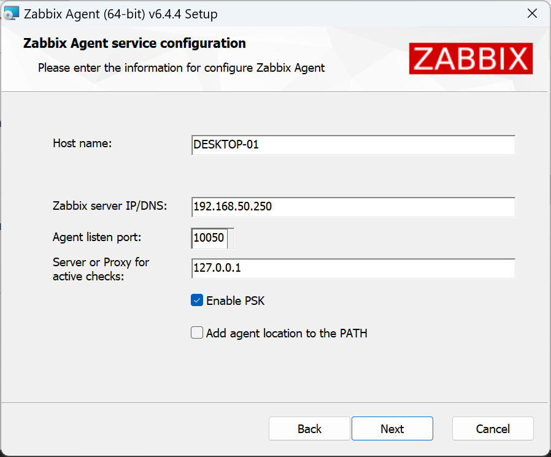
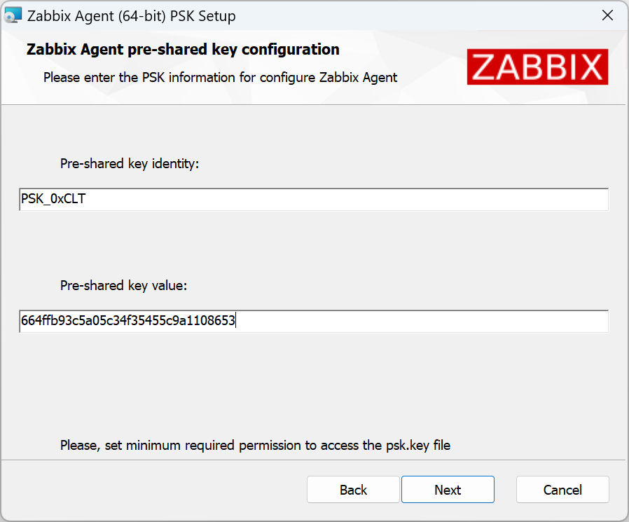
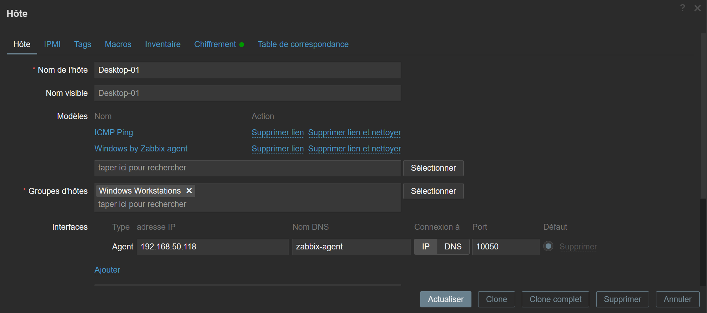
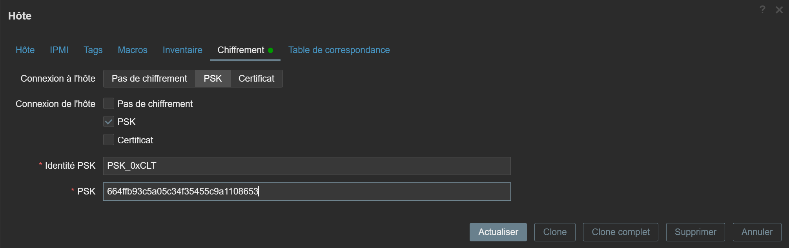

<!-- MASTER-HEADER-START -->
<div align="center">

<a href="https://0xcyberlitech.com/">
  
</a>

<p align="center">
  <a href="https://0xcyberlitech.com/"></a>
  <a href="https://0xcyberlitech.com/soc-rd.html"></a>
  <a href="https://0xcyberlitech.com/jarvis-rd.html"></a>
  <a href="https://github.com/0xCyberLiTech?tab=repositories"></a>
</p>
<p align="center">
  <a href="README.md"></a>
</p>


</div>
<!-- MASTER-HEADER-END -->

<!-- DEBIAN-TRUTH-START -->
> [!IMPORTANT]
>  ** Matrice Officielle Debian — `Debian 12 (Bookworm)` · `Debian 13 (Trixie)` · `Debian 14 (Forky)`**
> - **Sources Officielles Debian.org (`zabbix`) :** `Bookworm (12)` : **`1:6.0.14+dfsg-1`** &nbsp;·&nbsp; `Trixie (13 — Stable)` : **`1:7.0.22+dfsg-1~deb13u1`** &nbsp;·&nbsp; `Forky (14 — Next-Gen)` : **`1:7.0.29+dfsg-2`**
> - **Références Officielles :** [Paquet Debian Trixie (`zabbix-server-mysql`)](https://packages.debian.org/trixie/zabbix-server-mysql) &nbsp;·&nbsp; [Paquet Debian Forky (`zabbix-server-mysql`)](https://packages.debian.org/forky/zabbix-server-mysql) &nbsp;·&nbsp; [Documentation Officielle Debian](https://packages.debian.org/trixie/zabbix-server-mysql)
> - **Note d'Ingénierie (Divergence 13 vs 14) :** Sous Debian 13 (Trixie) et Debian 14 (Forky), privilégiez **`zabbix-agent2`** (écrit en Go, support natif Docker/Smartctl/Systemd) et les commandes `mariadb` / `php8.4-fpm`.

<details>
<summary> <b>Afficher les Encarts Ligne de Commande : Debian 13 (Trixie — Stable) vs Debian 14 (Forky — Next-Gen)</b></summary>

####  Profil Production Stable — Commandes pour `Debian 13 (Trixie)`
```bash
# Debian 13 (Trixie — Zabbix 7.0 LTS / 7.4 & MariaDB 11.4 / PHP 8.4) :
sudo systemctl status zabbix-server zabbix-agent2 apache2 mariadb
sudo journalctl -u zabbix-server -n 50 --no-hostname
```

####  Profil Anticipation Next-Gen — Commandes pour `Debian 14 (Forky)`
```bash
# Debian 14 (Forky) — Depot Zabbix au format DEB822 (/etc/apt/sources.list.d/zabbix.sources) :
sudo zabbix_server -R config_cache_reload
sudo zabbix_agent2 -t agent.ping
```

</details>
<!-- DEBIAN-TRUTH-END -->

<!-- CIEL-PEDAGOGY-START -->
<details>
<summary> <b>Synthèse d'Architecture, Standards Officiels &amp; Diagnostic (Niveau 1 : Fondamentaux · Niveau 2 : Repères · Niveau 3 : Diagnostic)</b></summary>

- **Niveau 1 — Fondamentaux &amp; Principe d'Architecture :** **Zabbix 7.4** est une plateforme industrielle de télémétrie et de supervision qui collecte en temps réel les métriques systèmes (via `zabbix-agent2` en Go), réseau (`SNMPv3`) et hyperviseurs (API REST), évalue des déclencheurs (**Triggers**) et orchestre les notifications d'incidents.
- **Niveau 2 — Repères Officiels (Ports IANA, Fichiers Debian &amp; Commandes de Validation) :** **Ports IANA :** `TCP 10050` (Agent passif) · `TCP 10051` (Serveur / Agent actif) · `UDP 161` (SNMP) · `TCP 443` (Web UI) &nbsp;|&nbsp; **Fichiers Debian :** `/etc/zabbix/zabbix_server.conf` et `/etc/zabbix/zabbix_agent2.conf` &nbsp;|&nbsp; **Validation officielle :** `sudo zabbix_agent2 -t agent.ping`.
- **Niveau 3 — Diagnostic d'Incidents &amp; Ingénierie Avancée :** **Diagnostic & Architecture :** Si un hôte demeure injoignable, vérifiez la concordance stricte du paramètre `Hostname=` et de l'IP autorisée dans `Server=` / `ServerActive=`. En mode **Passif**, le serveur interroge l'agent (`10050/tcp`) ; en mode **Actif**, l'agent initie le flux sortant vers le serveur (`10051/tcp`), traversant nativement les pare-feu.
- **Sources de Vérité Officielles Éditeurs &amp; Standards :** [Documentation Officielle Zabbix 7.4](https://www.zabbix.com/documentation/current/fr/manual) &nbsp;·&nbsp; [Dépôt Officiel Paquets Zabbix Debian](https://repo.zabbix.com/zabbix/)
- **Livres Blancs &amp; 67 Podcasts Audio R&amp;D :** [Portail 0xCyberLiTech](https://0xcyberlitech.com/) &nbsp;·&nbsp; [Livre Blanc SOC Cockpit v5.5](https://0xcyberlitech.com/soc-rd.html) &nbsp;·&nbsp; [Livre Blanc JARVIS Mark-VII](https://0xcyberlitech.com/jarvis-rd.html) &nbsp;·&nbsp; [Blueprint Logiciel &amp; Matériel RTX 5080](https://0xcyberlitech.com/blueprint-jarvis.html)

</details>
<!-- CIEL-PEDAGOGY-END -->


##  01 // ZABBIX - Sécurisation de la communication entre les agents Zabbix et le serveur Zabbix.


 Sommaire des sujets abordés :

- 01 - [ZABBIX - Intervention sur une machine Windows, déploiement de la clé PSK sur l'agent zabbix.](#balise-01)
- 02 - [ZABBIX - Intervention sur une machine Linux, déploiement de la clé PSK sur l'agent zabbix.](#balise-02)

<a name="balise-01"></a>
##  02 // 01 - Intervention sur une machine Windows, déploiement de la clé PSK sur l'agent zabbix.


Génération de la clé PSK.

Tout d'abord installer le paquet gnutls-bin.

<!-- CODE-WINDOW-START -->
> [!CAUTION]
> 
>
> ```bash
> apt-get install gnutls-bin
> ```
<!-- CODE-WINDOW-END -->

Par exemple, générer une clé PSK de 256 bits (32 octets).

<!-- CODE-WINDOW-START -->
> [!CAUTION]
> 
>
> ```bash
> psktool -u PSK_srv-linux-01 -p databasewindows.psk -s 32
> ```
<!-- CODE-WINDOW-END -->

Par exemple, générer une clé PSK de 128 bits (16 octets).

<!-- CODE-WINDOW-START -->
> [!CAUTION]
> 
>
> ```bash
> psktool -u PSK_srv-linux-01 -p databasewindows.psk -s 16
> ```
<!-- CODE-WINDOW-END -->

Un fichier est créé databasewindows.psk, il faudra y récupérer les informations générées.

<!-- CODE-WINDOW-START -->
> [!CAUTION]
> 
>
> ```bash
> cat databasewindows.psk
> ```
<!-- CODE-WINDOW-END -->

<!-- CODE-WINDOW-START -->
> [!CAUTION]
> 
>
> ```bash
> PSK_srv-linux-01:<CLE-PSK-256-BITS>
> ```
<!-- CODE-WINDOW-END -->

Sur cette ligne, on retrouve deux données :

- TLSPSKIdentity = PSK_srv-linux-01
- TLSPSKKey = <CLE-PSK-256-BITS>

- Ces deux données seront nécessaires pour paramétrer l'agent Zabbix Windows.
- Ces deux données seront également nécessaires pour déclarer la méthode de chiffrement (PSK) des Hôtes Windows sur le serveur Zabbix.

[URL officielle pour récupérer les agents Zabbix 7.4 Stable](https://www.zabbix.com/fr/download_agents?version=7.4)

Nous installons l'agent Zabbix 2 pour Windows (`zabbix_agent2-7.4.x-windows-amd64-openssl.msi`).

Lors de l'installation de l'agent Zabbix pour Windows, effectuer les réglages, voir captures d'écran ci-dessous :





Depuis le serveur Zabbix effectuer les réglages qui s'imposent :



Il faut se rendre sur l'onglet chiffrement et reproduire les mêmes actions :



<a name="balise-02"></a>
##  03 // 02 - Intervention sur une machine Linux, déploiement de la clé PSK sur l'agent zabbix.


[URL officielle pour récupérer les agents Zabbix 7.4 Stable](https://www.zabbix.com/fr/download_agents?version=7.4)

Nous supposons que l'agent zabbix est déja installé.

Nous devons maintenant modifier le fichier de configuration pour indiquer à l’agent où trouver le serveur.

Ouvrez /etc/zabbix/zabbix_agent2.conf dans votre éditeur de texte préféré et apportez les modifications suivantes pour indiquer à l’agent quels serveurs Zabbix sont autorisés à lui communiquer :

<!-- CODE-WINDOW-START -->
> [!CAUTION]
> 
>
> ```bash
> nano /etc/zabbix/zabbix_agent2.conf
> ```
<!-- CODE-WINDOW-END -->

- Server=[IP or hostname of your Zabbix server]
- ServerActive=[IP or hostname of your Zabbix server]

Nous devons également indiquer à Zabbix le nom d’hôte du système.

Il n’est pas nécessaire que ce soit le nom d’hôte réel, c’est le nom d’affichage que nous utiliserons dans Zabbix pour le système.

Commentez la valeur par défaut de Hostname=Zabbix server et remplacez-la par la valeur suivante :

<!-- CODE-WINDOW-START -->
> [!CAUTION]
> 
>
> ```bash
> HostnameItem=system.hostname
> ```
<!-- CODE-WINDOW-END -->

<!-- CODE-WINDOW-START -->
> [!CAUTION]
> 
>
> ```bash
> ### Option: Hostname
> #       List of comma delimited unique, case sensitive hostnames.
> #       Required for active checks and must match hostnames as configured on the server.
> #       Value is acquired from HostnameItem if undefined.
> #
> # Mandatory: no
> # Default:
> # Hostname=
>
> Hostname=system.hostname
> ```
<!-- CODE-WINDOW-END -->

Cela indiquera à l’agent de remplir automatiquement la valeur du nom d’hôte avec le nom d’hôte du système.

Vous pouvez simplement définir le nom d’hôte dans le fichier de configuration.

Cependant, le remplissage automatique vous permet de réutiliser le même fichier de configuration sur tous vos hôtes, ce qui simplifie l’automatisation si vous avez beaucoup d’hôtes à surveiller.

Démarrer l’agent 2

<!-- CODE-WINDOW-START -->
> [!CAUTION]
> 
>
> ```bash
> systemctl enable zabbix-agent2
> ```
<!-- CODE-WINDOW-END -->

<!-- CODE-WINDOW-START -->
> [!CAUTION]
> 
>
> ```bash
> systemctl start zabbix-agent2
> ```
<!-- CODE-WINDOW-END -->

Passons aux clés PSK :

Description :

Par défaut, la communication de l’agent se fait en texte clair.

Pour le cryptage, nous avons la possibilité d’utiliser le cryptage basé sur PSK.

PSK signifie clé pré-partagée.

L’option PSK se compose de deux valeurs importantes, l’identité PSK et le secret PSK.

La clé doit être au minimum axée sur une résolution de 128 bits (PSK de 16 octets, entré sous forme de 32 chiffres hexadécimaux) jusqu’à 2048 bits (PSK de 256 octets, entré sous la forme de 512 chiffres hexadécimaux).

Dans cet exemple, je l’enregistre également directement dans un fichier.

Je crée d’abord un dossier /etc/zabbix/psk_keys/.

<!-- CODE-WINDOW-START -->
> [!CAUTION]
> 
>
> ```bash
> mkdir -p /etc/zabbix/psk_keys/
> ```
<!-- CODE-WINDOW-END -->

<!-- CODE-WINDOW-START -->
> [!CAUTION]
> 
>
> ```bash
> cd /etc/zabbix/psk_keys/
> ```
<!-- CODE-WINDOW-END -->

Génération de la clé PSK.

<!-- CODE-WINDOW-START -->
> [!CAUTION]
> 
>
> ```bash
> openssl rand -hex 16 > database.psk
> ```
<!-- CODE-WINDOW-END -->

Un fichier est créé database.psk.

<!-- CODE-WINDOW-START -->
> [!CAUTION]
> 
>
> ```bash
> cat database.psk
> ```
<!-- CODE-WINDOW-END -->

<!-- CODE-WINDOW-START -->
> [!CAUTION]
> 
>
> ```bash
> <CLE-PSK-128-BITS>
> ```
<!-- CODE-WINDOW-END -->

Je m’assure également que seul l’utilisateur Zabbix peut lire le fichier.

<!-- CODE-WINDOW-START -->
> [!CAUTION]
> 
>
> ```bash
> chown zabbix:zabbix database.psk
> ```
<!-- CODE-WINDOW-END -->

<!-- CODE-WINDOW-START -->
> [!CAUTION]
> 
>
> ```bash
> chmod 640 database.psk
> ```
<!-- CODE-WINDOW-END -->

De plus, je reconfigure ensuite le fichier de configuration de l’agent Zabbix.

<!-- CODE-WINDOW-START -->
> [!CAUTION]
> 
>
> ```bash
> nano /etc/zabbix/zabbix_agent2.conf
> ```
<!-- CODE-WINDOW-END -->

Se rendre vers la fin du fichier, apporter les modifications suivantes :

<!-- CODE-WINDOW-START -->
> [!CAUTION]
> 
>
> ```bash
> ####### TLS-RELATED PARAMETERS #######
>
> ### Option: TLSConnect
> #       How the agent should connect to server or proxy. Used for active checks.
> #       Only one value can be specified:
> #               unencrypted - connect without encryption
> #               psk         - connect using TLS and a pre-shared key
> #               cert        - connect using TLS and a certificate
> #
> # Mandatory: yes, if TLS certificate or PSK parameters are defined (even for 'unencrypted' connection)
> # Default:
> TLSConnect=psk
> ```
<!-- CODE-WINDOW-END -->

<!-- CODE-WINDOW-START -->
> [!CAUTION]
> 
>
> ```bash
> ### Option: TLSAccept
> #       What incoming connections to accept.
> #       Multiple values can be specified, separated by comma:
> #               unencrypted - accept connections without encryption
> #               psk         - accept connections secured with TLS and a pre-shared key
> #               cert        - accept connections secured with TLS and a certificate
> #
> # Mandatory: yes, if TLS certificate or PSK parameters are defined (even for 'unencrypted' connection)
> # Default:
> TLSAccept=psk
> ```
<!-- CODE-WINDOW-END -->

<!-- CODE-WINDOW-START -->
> [!CAUTION]
> 
>
> ```bash
> ### Option: TLSPSKFile
> #       Full pathname of a file containing the pre-shared key.
> #
> # Mandatory: no
> # Default:
> TLSPSKFile=/etc/zabbix/psk_keys/database.psk
> ```
<!-- CODE-WINDOW-END -->

<!-- CODE-WINDOW-START -->
> [!CAUTION]
> 
>
> ```bash
> ### Option: TLSPSKIdentity
> #       Unique, case sensitive string used to identify the pre-shared key.
> #
> # Mandatory: no
> # Default:
> TLSPSKIdentity=pskident
> ```
<!-- CODE-WINDOW-END -->

Récapitulatif :

<!-- CODE-WINDOW-START -->
> [!CAUTION]
> 
>
> ```bash
> TLSConnect=psk
> TLSAccept=psk
> TLSPSKFile=/etc/zabbix/psk_keys/database.psk
> TLSPSKIdentity=pskident
> ```
<!-- CODE-WINDOW-END -->

La valeur TLSPSKIdentity que vous décidez de créer ne sera pas chiffrée lors du transport, n’utilisez donc rien de sensible.

Je redémarre ensuite l’agent.

<!-- CODE-WINDOW-START -->
> [!CAUTION]
> 
>
> ```bash
> systemctl restart zabbix-agent2.service
> ```
<!-- CODE-WINDOW-END -->

Je vais ensuite dans l’interface utilisateur du serveur Zabbix et configure les options de cryptage PSK pour l’hôte.

De plus, je sélectionne l’icône.

'Connexions à l’hôte' = PSK

'Connexions depuis l’hôte' = PSK

'PSK Identity' = [tout ce que vous avez utilisé dans la configuration de l’agent Zabbix]

'PSK' = [la longue chaîne hexadécimale générée à partir de la commande OpenSSL ci-dessus]

Après une minute ou deux, le serveur et l’agent Zabbix communiqueront avec succès en utilisant le cryptage PSK.

PSK derrière un proxy :

La configuration du chiffrement PSK sur les agents derrière un proxy n’est pas nécessaire s’ils s’exécutent tous sur le même réseau privé interne, sauf si votre stratégie de sécurité recommande également un certain niveau de chiffrement sur vos réseaux internes.

Ce que vous devez faire en premier à la place, c’est activer PSK pour les communications entre votre serveur Zabbix et Zabbix Proxy.

Vous devez créer un nouveau secret, et ajouter l’identité et le secret PSK à Administration ⇾ Proxies ⇾ [Votre proxy] ⇾ Cryptage et également ajuster les paramètres à l’intérieur du fichier de configuration des proxys dans /etc/zabbix/zabbix_proxy.conf.

Avertissement :

Si vous configurez le chiffrement PSK pour les agents derrière un proxy Zabbix, assurez-vous que Zabbix Server ⇽⇾ Proxy PSK est activé en premier. En effet, lorsque vous démarrez le proxy ou effectuez une config_cache_reload, le proxy télécharge tous ses paramètres d’hôte à partir du serveur, ce qui inclut également la copie du secret par le serveur.

Le proxy doit connaître le secret puisqu’il gère maintenant les communications au nom du serveur.

Si vous voulez un cryptage PSK pour tous les agents derrière un proxy, vous continuez à configurer les agents comme d’habitude en créant un nouveau secret, en y éditant la page Configuration ⇾ Hosts ⇾ [Your Host] ⇾ Encryption, et en éditant également leur propre fichier de configuration dans /etc/zabbix/zabbix_agentd.conf.

N’oubliez pas que, puisque la configuration de votre hôte d’agents dans l’interface utilisateur Zabbix sera définie comme surveillée par proxy, les paramètres PSK seront applicables aux communications entre le proxy Zabbix et l’agent qu’il surveille. Pas entre le serveur Zabbix et l’agent derrière le proxy.

Vous pouvez également ajouter le cryptage PSK entre votre proxy Zabbix et son propre agent local si vous le souhaitez. Vous devez définir ses paramètres PSK dans la configuration de l’hôte des agents proxy dans Configuration ⇾ Hôtes ⇾ [Votre proxy] ⇾ Cryptage, et modifier les paramètres dans les agents sur le fichier de configuration dans /etc/zabbix/zabbix_agentd.conf. N’oubliez pas que cela ne s’applique qu’aux communications entre le proxy Zabbix et son propre processus d’agent.

Lors de la configuration du cryptage PSK pour le serveur, le proxy et les agents Zabbix, vous pouvez voir une erreur dans les journaux du proxy,

cannot send proxy data to server at "zabbix.your-domain.tld": connection of type "TLS with PSK" is not allowed for proxy "your-proxy".

Vérifiez d’abord que les paramètres PSK de votre serveur Zabbix ⇽⇾ proxy sont corrects. Ne confondez pas le processus d’agent optionnel des proxys et son processus proxy principal requis.

Dépannage :

Vérifiez les journaux de l’agent Zabbix à l’adresse.

<!-- CODE-WINDOW-START -->
> [!CAUTION]
> 
>
> ```bash
> tail -f /var/log/zabbix/zabbix_agent2.log
> ```
<!-- CODE-WINDOW-END -->

Si tout est OK :

<!-- CODE-WINDOW-START -->
> [!CAUTION]
> 
>
> ```bash
> 2025/09/14 22:24:45.639298 Plugin communication protocol version is 7.4.0
> 2025/09/14 22:24:45.639317 Zabbix Agent2 hostname: [Zabbix server]
> ```
<!-- CODE-WINDOW-END -->

<!-- MASTER-FOOTER-START -->
<div align="center">


<a href="https://0xcyberlitech.com/">
  
</a>

<p align="center"><a href="https://0xcyberlitech.com/"></a></p>

<sub><b>Architecturé &amp; Forgé par Marc &amp; Antigravity (Google DeepMind)</b> &nbsp;·&nbsp; <a href="https://0xcyberlitech.com/"><b>0xcyberlitech.com</b></a> &nbsp;·&nbsp; <a href="https://0xcyberlitech.com/soc-rd.html">Architecture SOC Cockpit v5.5</a> &nbsp;·&nbsp; <a href="https://0xcyberlitech.com/jarvis-rd.html">Architecture JARVIS Mark-VII</a> &nbsp;·&nbsp; <a href="https://0xcyberlitech.com/blueprint-jarvis.html">Blueprint Matériel RTX 5080</a></sub>

</div>
<!-- MASTER-FOOTER-END -->
