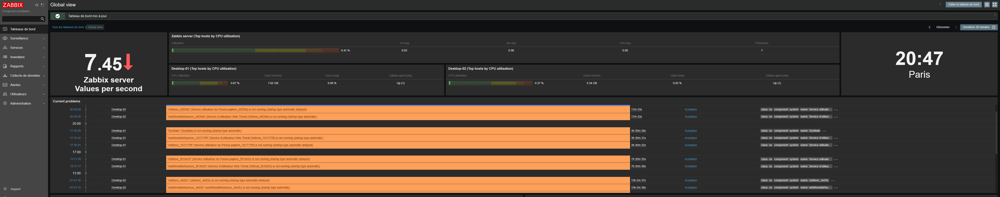
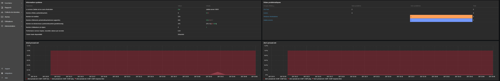
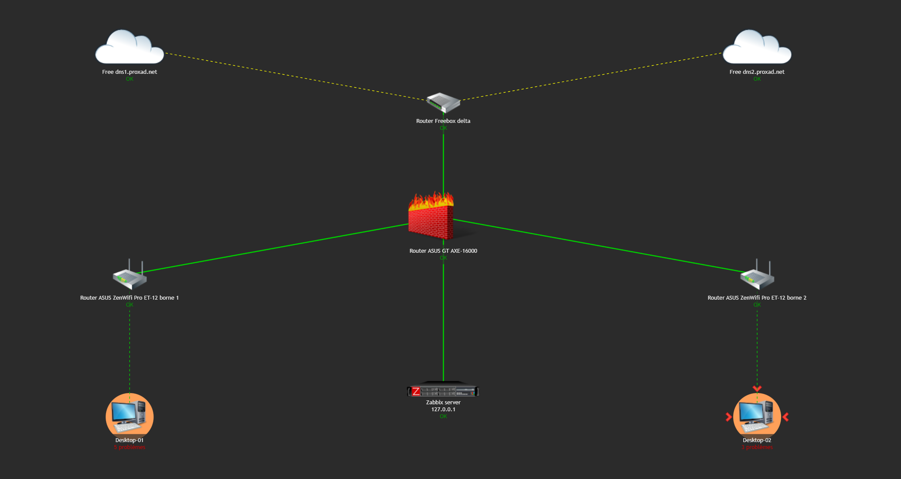

<!-- MASTER-HEADER-START -->
<div align="center">

<a href="https://0xcyberlitech.com/">
  
</a>

<p align="center">
  <a href="https://0xcyberlitech.com/"></a>
  <a href="https://0xcyberlitech.com/soc-rd.html"></a>
  <a href="https://0xcyberlitech.com/jarvis-rd.html"></a>
  <a href="https://github.com/0xCyberLiTech?tab=repositories"></a>
</p>
<p align="center">
  <a href="README.md"></a>
</p>


</div>
<!-- MASTER-HEADER-END -->

<!-- DEBIAN-TRUTH-START -->
> [!IMPORTANT]
>  ** Matrice Officielle Debian — `Debian 12 (Bookworm)` · `Debian 13 (Trixie)` · `Debian 14 (Forky)`**
> - **Sources Officielles Debian.org (`zabbix`) :** `Bookworm (12)` : **`1:6.0.14+dfsg-1`** &nbsp;·&nbsp; `Trixie (13 — Stable)` : **`1:7.0.22+dfsg-1~deb13u1`** &nbsp;·&nbsp; `Forky (14 — Next-Gen)` : **`1:7.0.29+dfsg-2`**
> - **Références Officielles :** [Paquet Debian Trixie (`zabbix-server-mysql`)](https://packages.debian.org/trixie/zabbix-server-mysql) &nbsp;·&nbsp; [Paquet Debian Forky (`zabbix-server-mysql`)](https://packages.debian.org/forky/zabbix-server-mysql) &nbsp;·&nbsp; [Documentation Officielle Debian](https://packages.debian.org/trixie/zabbix-server-mysql)
> - **Note d'Ingénierie (Divergence 13 vs 14) :** Sous Debian 13 (Trixie) et Debian 14 (Forky), privilégiez **`zabbix-agent2`** (écrit en Go, support natif Docker/Smartctl/Systemd) et les commandes `mariadb` / `php8.4-fpm`.

<details>
<summary> <b>Afficher les Encarts Ligne de Commande : Debian 13 (Trixie — Stable) vs Debian 14 (Forky — Next-Gen)</b></summary>

####  Profil Production Stable — Commandes pour `Debian 13 (Trixie)`
```bash
# Debian 13 (Trixie — Zabbix 7.0 LTS / 7.4 & MariaDB 11.4 / PHP 8.4) :
sudo systemctl status zabbix-server zabbix-agent2 apache2 mariadb
sudo journalctl -u zabbix-server -n 50 --no-hostname
```

####  Profil Anticipation Next-Gen — Commandes pour `Debian 14 (Forky)`
```bash
# Debian 14 (Forky) — Depot Zabbix au format DEB822 (/etc/apt/sources.list.d/zabbix.sources) :
sudo zabbix_server -R config_cache_reload
sudo zabbix_agent2 -t agent.ping
```

</details>
<!-- DEBIAN-TRUTH-END -->

<!-- CIEL-PEDAGOGY-START -->
<details>
<summary> <b>Synthèse d'Architecture, Standards Officiels &amp; Diagnostic (Niveau 1 : Fondamentaux · Niveau 2 : Repères · Niveau 3 : Diagnostic)</b></summary>

- **Niveau 1 — Fondamentaux &amp; Principe d'Architecture :** **Zabbix 7.4** est une plateforme industrielle de télémétrie et de supervision qui collecte en temps réel les métriques systèmes (via `zabbix-agent2` en Go), réseau (`SNMPv3`) et hyperviseurs (API REST), évalue des déclencheurs (**Triggers**) et orchestre les notifications d'incidents.
- **Niveau 2 — Repères Officiels (Ports IANA, Fichiers Debian &amp; Commandes de Validation) :** **Ports IANA :** `TCP 10050` (Agent passif) · `TCP 10051` (Serveur / Agent actif) · `UDP 161` (SNMP) · `TCP 443` (Web UI) &nbsp;|&nbsp; **Fichiers Debian :** `/etc/zabbix/zabbix_server.conf` et `/etc/zabbix/zabbix_agent2.conf` &nbsp;|&nbsp; **Validation officielle :** `sudo zabbix_agent2 -t agent.ping`.
- **Niveau 3 — Diagnostic d'Incidents &amp; Ingénierie Avancée :** **Diagnostic & Architecture :** Si un hôte demeure injoignable, vérifiez la concordance stricte du paramètre `Hostname=` et de l'IP autorisée dans `Server=` / `ServerActive=`. En mode **Passif**, le serveur interroge l'agent (`10050/tcp`) ; en mode **Actif**, l'agent initie le flux sortant vers le serveur (`10051/tcp`), traversant nativement les pare-feu.
- **Sources de Vérité Officielles Éditeurs &amp; Standards :** [Documentation Officielle Zabbix 7.4](https://www.zabbix.com/documentation/current/fr/manual) &nbsp;·&nbsp; [Dépôt Officiel Paquets Zabbix Debian](https://repo.zabbix.com/zabbix/)
- **Livres Blancs &amp; 67 Podcasts Audio R&amp;D :** [Portail 0xCyberLiTech](https://0xcyberlitech.com/) &nbsp;·&nbsp; [Livre Blanc SOC Cockpit v5.5](https://0xcyberlitech.com/soc-rd.html) &nbsp;·&nbsp; [Livre Blanc JARVIS Mark-VII](https://0xcyberlitech.com/jarvis-rd.html) &nbsp;·&nbsp; [Blueprint Logiciel &amp; Matériel RTX 5080](https://0xcyberlitech.com/blueprint-jarvis.html)

</details>
<!-- CIEL-PEDAGOGY-END -->


images_build.yml
https://github.com/zabbix/zabbix-docker/actions/workflows/images_build.yml

#  - ZABBIX — Déploiement sous Docker & Docker Compose v2 de Zabbix 7.4 Stable (MariaDB 11.4 LTS & zabbix-agent2)

Pour l’installation de Zabbix 7.4 Stable avec Docker Compose v2 sous **Debian 12 (Bookworm)**, **Debian 13 (Trixie)** et **Debian 14 (Forky)**, nous utilisons un fichier `docker-compose.yml` déclarant les conteneurs suivants :

- Le serveur Zabbix (`zabbix/zabbix-server-mysql:alpine-7.4-latest`).
- La base de données MariaDB LTS (`mariadb:11.4`).
- L’interface Web Nginx (`zabbix/zabbix-web-nginx-mysql:alpine-7.4-latest`).
- L’agent de supervision nouvelle génération (`zabbix/zabbix-agent2:alpine-7.4-latest`).

Prérequis :

Cette procédure est validée sous **Debian 12 (Bookworm)**, **Debian 13 (Trixie — Stable)** et **Debian 14 (Forky — Next-Gen)** avec **Docker Engine**, **Docker Compose v2** (`docker compose`) et **Portainer**.

Vous trouverez ici un tutoriel sur l’installation de Docker, Docker compose v2 & Portainer.

- Installation manuelle de Docker Engine et Docker-compose-plugin v2, [disponible ici](https://github.com/0xCyberLiTech/Docker/blob/main/DOCKER-et-DOCKER-COMPOSE-Installation-manuelle-13.md)

- Installation manuelle de Portainer, [disponible ici](https://github.com/0xCyberLiTech/Docker/blob/main/PORTAINER-Installation-manuelle.md)

Sur votre serveur, créer un dossier, qui va recevoir une copie des fichiers du dépôt et les données de Zabbix.

- Avant de commencer il faut installer et configurer (NTPsec).

[Installer et configurer (NTPsec)](https://github.com/0xCyberLiTech/NTPsec/blob/main/Installer-et-configurer-NTPsec.md)

Création du dossier ~/zabbix/.

<!-- CODE-WINDOW-START -->
> [!CAUTION]
> 
>
> ```bash
> mkdir ~/zabbix/
> ```
<!-- CODE-WINDOW-END -->

<!-- CODE-WINDOW-START -->
> [!CAUTION]
> 
>
> ```bash
> cd ~/zabbix/
> ```
<!-- CODE-WINDOW-END -->

Aller dans ce dossier, entrer la commande ci-dessous pour récupérer les fichiers nécessaires à l'installation de Zabbix :

<!-- CODE-WINDOW-START -->
> [!CAUTION]
> 
>
> ```bash
> sudo git clone https://github.com/zabbix/zabbix-docker.git .
> ```
<!-- CODE-WINDOW-END -->

Avant de récupérer les images et de les démarrer, je vous conseille de modifier les mots de passe pour la base MariaDB.

Aller dans le dossier (env_vars/) qui contient les différents fichiers de configuration.

<!-- CODE-WINDOW-START -->
> [!CAUTION]
> 
>
> ```bash
> cd env_vars
> ```
<!-- CODE-WINDOW-END -->

Éditer les fichiers (.MYSQL_PASSWORD) et (.MYSQL_ROOT_PASSWORD) changer par un mot de passe personnalisé.

Remonter d’un niveau dans les dossiers pour retourner où se trouve le fichier docker-compose.yml.

<!-- CODE-WINDOW-START -->
> [!CAUTION]
> 
>
> ```bash
> cd ..
> ```
<!-- CODE-WINDOW-END -->

On va maintenant pouvoir télécharger les images, avant je vous invite à lire le fichier docker-compose.yml dont voici un aperçu :

<!-- CODE-WINDOW-START -->
> [!CAUTION]
> 
>
> ```yaml
> services:
>   zabbix-server:
>     image: zabbix/zabbix-server-mysql:alpine-7.4-latest
>     restart: always
>     ports:
>       - "10051:10051"
>     volumes:
>       - /etc/localtime:/etc/localtime:ro
>       - /etc/timezone:/etc/timezone:ro
>       - ./zbx_env/usr/lib/zabbix/alertscripts:/usr/lib/zabbix/alertscripts:ro
>       - ./zbx_env/usr/lib/zabbix/externalscripts:/usr/lib/zabbix/externalscripts:ro
>       - ./zbx_env/var/lib/zabbix/export:/var/lib/zabbix/export:rw
>       - ./zbx_env/var/lib/zabbix/modules:/var/lib/zabbix/modules:ro
>       - ./zbx_env/var/lib/zabbix/enc:/var/lib/zabbix/enc:ro
>       - ./zbx_env/var/lib/zabbix/ssh_keys:/var/lib/zabbix/ssh_keys:ro
>       - ./zbx_env/var/lib/zabbix/mibs:/var/lib/zabbix/mibs:ro
>       - snmptraps:/var/lib/zabbix/snmptraps:rw
>     deploy:
>       resources:
>         limits:
>           memory: 2G
>         reservations:
>           memory: 1G
>     env_file:
>       - ./env_vars/.env_db_mysql
>       - ./env_vars/.env_srv
>     secrets:
>       - MYSQL_USER
>       - MYSQL_PASSWORD
>       - MYSQL_ROOT_PASSWORD
>     depends_on:
>       - mysql-server
>     networks:
>       zbx_net_backend:
>         aliases:
>           - zabbix-server
>           - zabbix-server-mysql
>           - zabbix-server-alpine-mysql
>           - zabbix-server-mysql-alpine
>       zbx_net_frontend:
>     stop_grace_period: 30s
>     sysctls:
>       - net.ipv4.ip_local_port_range=1024 65000
>       - net.ipv4.conf.all.accept_redirects=0
>       - net.ipv4.conf.all.secure_redirects=0
>       - net.ipv4.conf.all.send_redirects=0
>     labels:
>       com.zabbix.description: "Zabbix 7.4 server with MySQL/MariaDB database support"
>       com.zabbix.company: "Zabbix LLC"
>       com.zabbix.component: "zabbix-server"
>       com.zabbix.dbtype: "mysql"
>       com.zabbix.os: "alpine"
>
>   zabbix-web-nginx-mysql:
>     image: zabbix/zabbix-web-nginx-mysql:alpine-7.4-latest
>     restart: always
>     ports:
>       - "8080:8080"
>       - "8443:8443"
>     volumes:
>       - /etc/localtime:/etc/localtime:ro
>       - /etc/timezone:/etc/timezone:ro
>       - ./zbx_env/etc/ssl/nginx:/etc/ssl/nginx:ro
>       - ./zbx_env/usr/share/zabbix/modules/:/usr/share/zabbix/modules/:ro
>     deploy:
>       resources:
>         limits:
>           memory: 1G
>         reservations:
>           memory: 512M
>     env_file:
>       - ./env_vars/.env_db_mysql
>       - ./env_vars/.env_web
>     secrets:
>       - MYSQL_USER
>       - MYSQL_PASSWORD
>     depends_on:
>       - mysql-server
>       - zabbix-server
>     healthcheck:
>       test: ["CMD", "curl", "-f", "http://localhost:8080/"]
>       interval: 10s
>       timeout: 5s
>       retries: 3
>       start_period: 30s
>     networks:
>       zbx_net_backend:
>         aliases:
>         - zabbix-web-nginx-mysql
>         - zabbix-web-nginx-alpine-mysql
>         - zabbix-web-nginx-mysql-alpine
>       zbx_net_frontend:
>     stop_grace_period: 10s
>     sysctls:
>     - net.core.somaxconn=65535
>     labels:
>       com.zabbix.description: "Zabbix 7.4 frontend on Nginx web-server with MySQL database support"
>       com.zabbix.company: "Zabbix LLC"
>       com.zabbix.component: "zabbix-frontend"
>       com.zabbix.webserver: "nginx"
>       com.zabbix.dbtype: "mysql"
>       com.zabbix.os: "alpine"
>
>   mysql-server:
>     # https://hub.docker.com/_/mariadb
>     image: mariadb:11.4
>     restart: always
>     command:
>       - mariadbd
>       - --character-set-server=utf8mb4
>       - --collation-server=utf8mb4_bin
>       - --skip-character-set-client-handshake
>     volumes:
>       - ./zbx_env/var/lib/mysql:/var/lib/mysql:rw
>     env_file:
>       - ./env_vars/.env_db_mysql
>     secrets:
>       - MYSQL_USER
>       - MYSQL_PASSWORD
>       - MYSQL_ROOT_PASSWORD
>     stop_grace_period: 1m
>     networks:
>       zbx_net_backend:
>         aliases:
>         - mysql-server
>         - zabbix-database
>         - mysql-database
>
>   zabbix-agent2:
>     image: zabbix/zabbix-agent2:alpine-7.4-latest
>     restart: always
>     ports:
>       - "10050:10050"
>     volumes:
>       - /etc/localtime:/etc/localtime:ro
>       - /etc/timezone:/etc/timezone:ro
>       - ./zbx_env/etc/zabbix/zabbix_agentd.d:/etc/zabbix/zabbix_agentd.d:ro
>       - ./zbx_env/var/lib/zabbix/modules:/var/lib/zabbix/modules:ro
>       - ./zbx_env/var/lib/zabbix/enc:/var/lib/zabbix/enc:ro
>       - ./zbx_env/var/lib/zabbix/ssh_keys:/var/lib/zabbix/ssh_keys:ro
>     env_file:
>       - ./env_vars/.env_agent
>     networks:
>       zbx_net_backend:
>         aliases:
>         - zabbix-agent
>         - zabbix-agent2
>         - zabbix-agent-passive
>         - zabbix-agent-alpine
>
> networks:
>   zbx_net_frontend:
>     driver: bridge
>     driver_opts:
>       com.docker.network.enable_ipv6: "false"
>     ipam:
>       driver: default
>       config:
>       - subnet: 172.16.238.0/24
>   zbx_net_backend:
>     driver: bridge
>     driver_opts:
>       com.docker.network.enable_ipv6: "false"
>     internal: true
>     ipam:
>       driver: default
>       config:
>       - subnet: 172.16.239.0/24
>
> volumes:
>   snmptraps:
>
> secrets:
>   MYSQL_USER:
>     file: ./env_vars/.MYSQL_USER
>   MYSQL_PASSWORD:
>     file: ./env_vars/.MYSQL_PASSWORD
>   MYSQL_ROOT_PASSWORD:
>     file: ./env_vars/.MYSQL_ROOT_PASSWORD
> ```
<!-- CODE-WINDOW-END -->

Télécharger les différentes images :

<!-- CODE-WINDOW-START -->
> [!CAUTION]
> 
>
> ```bash
> sudo docker compose pull
> ```
<!-- CODE-WINDOW-END -->

Lancer les conteneurs pour démarrer Zabbix.

Pour le premier démarrage, je vous conseille de ne pas détacher l’exécution des conteneurs afin d’avoir le retour dans le terminal, pour cela ont démarré les conteneurs sans l’option -d.

Entrer la commande suivante :

<!-- CODE-WINDOW-START -->
> [!CAUTION]
> 
>
> ```bash
> sudo docker compose up
> ```
<!-- CODE-WINDOW-END -->

Le meilleur moyen de savoir si tout a fonctionné maintenant et d’essayer d’aller sur Zabbix depuis un navigateur.

Identifiant de connexion par défaut :

<!-- CODE-WINDOW-START -->
> [!CAUTION]
> 
>
> ```bash
> Admin / zabbix
> ```
<!-- CODE-WINDOW-END -->

Depuis un navigateur Internet, entrer l’adresse http://ip_server_zabbix:8080







#  Sauvegarde :

Dump Base de Données :

Récupération de l'ID du container :

<!-- CODE-WINDOW-START -->
> [!CAUTION]
> 
>
> ```bash
> docker ps -a
> ```
<!-- CODE-WINDOW-END -->

Retour :

<!-- CODE-WINDOW-START -->
> [!CAUTION]
> 
>
> ```bash
> ID : d5613cca8slEZZ / name : zabbix-mysql-server-1
> ```
<!-- CODE-WINDOW-END -->

#  Sauvegarder la base de Donnée zabbix :

<!-- CODE-WINDOW-START -->
> [!CAUTION]
> 
>
> ```bash
> cd ~
> ```
<!-- CODE-WINDOW-END -->

<!-- CODE-WINDOW-START -->
> [!CAUTION]
> 
>
> ```bash
> docker exec d5613cca8slEZZ /usr/bin/mysqldump -u zabbix --password=zabbix zabbix > backup_zabbix_mariadb_10.11.4_20-07-2023.sql
> ```
<!-- CODE-WINDOW-END -->

#  Restaurer la base de Donnée zabbix :

Récupération de l'ID du container :

<!-- CODE-WINDOW-START -->
> [!CAUTION]
> 
>
> ```bash
> docker ps -a
> ```
<!-- CODE-WINDOW-END -->

Retour :

<!-- CODE-WINDOW-START -->
> [!CAUTION]
> 
>
> ```bash
> ID : d5613cca8slEZZ / name : zabbix-mysql-server-1
> ```
<!-- CODE-WINDOW-END -->

Exécution de la restauration de la base de données zabbix :

<!-- CODE-WINDOW-START -->
> [!CAUTION]
> 
>
> ```bash
> cd ~
> ```
<!-- CODE-WINDOW-END -->

<!-- CODE-WINDOW-START -->
> [!CAUTION]
> 
>
> ```bash
> cat backup_zabbix_mariadb_10.11.4_20-07-2023.sql | docker exec -i d5613cca8slEZZ /usr/bin/mysql -u root --password=x0xT_sxR3aZ zabbix
> ```
<!-- CODE-WINDOW-END -->

#  Autres commandes utiles :

- Accéder à un container et se connecter à sa console MySQL depuis Windows :

Depuis l'hôte pour accéder au serveur MySQL se trouvant sur le container d5613cca8slEZZ exécuter les commandes suivantes :

Identification du container :

<!-- CODE-WINDOW-START -->
> [!CAUTION]
> 
>
> ```bash
> docker ps -a
> ```
<!-- CODE-WINDOW-END -->

<!-- CODE-WINDOW-START -->
> [!CAUTION]
> 
>
> ```bash
> Retour :
> ```
<!-- CODE-WINDOW-END -->

<!-- CODE-WINDOW-START -->
> [!CAUTION]
> 
>
> ```bash
> ID : d5613cca8slEZZ / name : zabbix-mysql-server-1
> ```
<!-- CODE-WINDOW-END -->

Puis se connecter au container :

<!-- CODE-WINDOW-START -->
> [!CAUTION]
> 
>
> ```bash
> docker exec -it d5613cca8slEZZ mysql mysql -uroot -p
> ```
<!-- CODE-WINDOW-END -->

Autres exemples :

- Copier un fichier depuis le container vers l'hôte : 

<!-- CODE-WINDOW-START -->
> [!CAUTION]
> 
>
> ```bash
> docker cp zabbix-zabbix-server-1:/etc/zabbix/zabbix_server.conf ./
> ```
<!-- CODE-WINDOW-END -->

- Copier un fichier depuis l'hôte vers le container :

<!-- CODE-WINDOW-START -->
> [!CAUTION]
> 
>
> ```bash
> docker cp ./zabbix_server.conf zabbix-zabbix-server-1:/etc/zabbix/
> ```
<!-- CODE-WINDOW-END -->

#  Transfert de fichier depuis Windows :

Depuis la console CMD (ADMIN) :

Déposer un fichier en provenance du serveur linux root@192.168.50.201:/root/BACKUP_ZABBIX/ vers le dossier D:\DOSSIER_BACKUP sur la machine Windows.

<!-- CODE-WINDOW-START -->
> [!CAUTION]
> 
>
> ```bash
> pscp.exe -P <port ssh> username@ip:/chemin/vers/le/fichier /chemin/local
> pscp.exe -P 2234 root@192.168.50.201:/root/BACKUP_ZABBIX/* D:\DOSSIER_BACKUP
> ```
<!-- CODE-WINDOW-END -->

Depuis la console CMD :

Déposer un dossier et tout son contenu en provenance du serveur distant Linux root@192.168.50.201:/root/BACKUP_ZABBIX/ vers le dossier D:\DOSSIER_BACKUP sur la machine Windows.

<!-- CODE-WINDOW-START -->
> [!CAUTION]
> 
>
> ```bash
> pscp.exe -r -P <port ssh> username@ip:/chemin/vers/le/fichier /chemin/local
> pscp.exe -r -P 2234 root@192.168.50.250:/root/BACKUP_ZABBIX/* D:\DOSSIER_BACKUP
> ```
<!-- CODE-WINDOW-END -->

Concernant les règles de firewall (UFW) :

<!-- CODE-WINDOW-START -->
> [!CAUTION]
> 
>
> ```bash
> [ 1] 80/tcp                     ALLOW IN    192.168.50.0/24
> [ 2] 443/tcp                    ALLOW IN    192.168.50.0/24
> [ 3] 2234/tcp                   ALLOW IN    192.168.50.0/24
> [ 4] 10050/tcp                  ALLOW IN    192.168.50.0/24 # Zabbix
> [ 5] 9443/tcp                   ALLOW IN    192.168.50.0/24 # Portainer
> [ 6] 9392/tcp                   ALLOW IN    192.168.0.0/16
> [ 7] 8181/tcp                   ALLOW IN    192.168.50.0/24
> [ 8] 8585/tcp                   ALLOW IN    192.168.50.0/24
> [ 9] 8086/tcp                   ALLOW IN    192.168.50.0/24
> [10] 1883/tcp                   ALLOW IN    192.168.50.0/24
> [11] 25/tcp                     ALLOW IN    192.168.50.0/24
> [12] Anywhere                   ALLOW IN    172.21.0.0/16
> [13] Anywhere                   ALLOW IN    172.22.0.0/16
>
> ```
<!-- CODE-WINDOW-END -->

Il faut ouvrir le port 3000 pour Grafana, mais cela ne suffit pas si Grafana est installé dans un container.

<!-- CODE-WINDOW-START -->
> [!CAUTION]
> 
>
> ```bash
> [12] Anywhere                   ALLOW IN    172.21.0.0/16 # Docker
> [13] Anywhere                   ALLOW IN    172.22.0.0/16 # Docker
> ```
<!-- CODE-WINDOW-END -->

<!-- MASTER-FOOTER-START -->
<div align="center">


<a href="https://0xcyberlitech.com/">
  
</a>

<p align="center"><a href="https://0xcyberlitech.com/"></a></p>

<sub><b>Architecturé &amp; Forgé par Marc &amp; Antigravity (Google DeepMind)</b> &nbsp;·&nbsp; <a href="https://0xcyberlitech.com/"><b>0xcyberlitech.com</b></a> &nbsp;·&nbsp; <a href="https://0xcyberlitech.com/soc-rd.html">Architecture SOC Cockpit v5.5</a> &nbsp;·&nbsp; <a href="https://0xcyberlitech.com/jarvis-rd.html">Architecture JARVIS Mark-VII</a> &nbsp;·&nbsp; <a href="https://0xcyberlitech.com/blueprint-jarvis.html">Blueprint Matériel RTX 5080</a></sub>

</div>
<!-- MASTER-FOOTER-END -->
